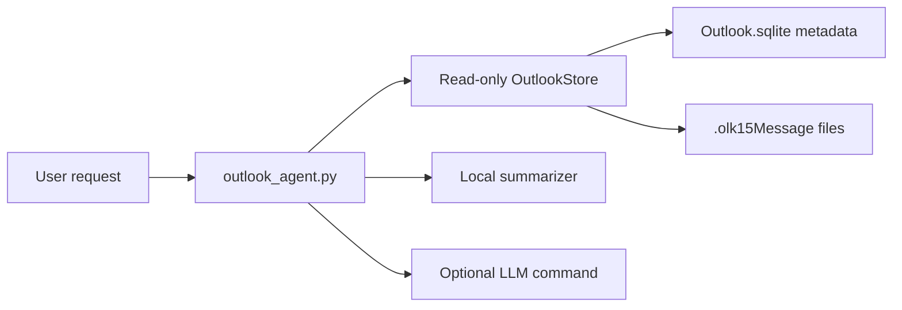

# Local Outlook Agent

This is a first-pass local mail agent for Outlook for Mac when Exchange, Graph,
or EWS are not available.

It reads Outlook's local profile database directly:

```text
~/Library/Group Containers/UBF8T346G9.Office/Outlook/Outlook 15 Profiles/Main Profile/Data/Outlook.sqlite
```

The connector opens SQLite in read-only mode and does not ask Outlook to mark
messages as read, move mail, send mail, or sync.

## What Works Now

- Check whether the local Outlook profile is readable.
- List recent messages by folder, unread state, date, or search query.
- Show a selected message.
- Summarize selected or recent messages with a local extractive summarizer.
- Retrieve likely relevant messages for a question.
- Optionally send selected message excerpts to any external LLM command.

## Quick Start

```bash
python3 outlook_agent.py doctor
python3 outlook_agent.py list --limit 10
python3 outlook_agent.py list --unread --limit 20
python3 outlook_agent.py list --query "invoice" --since 2026-06-01
python3 outlook_agent.py summarize --unread --limit 5
python3 outlook_agent.py show 12345 --full
python3 outlook_agent.py ask "what emails need a reply from me?"
python3 outlook_agent.py chat
```

If your Outlook profile is somewhere else:

```bash
OUTLOOK_DB="/path/to/Outlook.sqlite" python3 outlook_agent.py doctor
```

## Optional LLM Hook

By default, summaries are local and heuristic. Chat can retrieve matching
messages without an LLM, but it needs an LLM command to synthesize answers. Set
`OUTLOOK_AGENT_LLM_CMD` to any command that receives the prompt on stdin and
prints the answer to stdout.

Examples:

```bash
OUTLOOK_AGENT_LLM_CMD="llm -m gpt-4.1-mini" python3 outlook_agent.py summarize --limit 3
OUTLOOK_AGENT_LLM_CMD="ollama run llama3.1" python3 outlook_agent.py ask "summarize travel updates"
OUTLOOK_AGENT_LLM_CMD="ollama run llama3.1" python3 outlook_agent.py chat
```

This keeps the Outlook connector independent from any one model provider.

## Chat Agent

Start an interactive mailbox chat:

```bash
cd /Users/juan/Documents/github/outlookagent
python3 outlook_agent.py chat
```

Inside chat:

```text
mail> what emails need a reply from me?
mail> summarize messages from finance this week
mail> /unread
mail> /recent
mail> /summary 12345
mail> /show 12345
mail> /quit
```

For a convenient shell command, add this to `~/.zshrc`:

```bash
alias outlook-chat='cd /Users/juan/Documents/github/outlookagent && python3 outlook_agent.py chat'
```

Then open a new terminal and run:

```bash
outlook-chat
```

## Privacy Model

- The default `doctor` command reports only counts and paths.
- `list` prints metadata and Outlook's preview text.
- `show`, `summarize`, and `ask` read message files for selected messages.
- `chat` reads message files only for the messages retrieved for your question
  or for a message id you explicitly request.
- Nothing is sent to a model unless `OUTLOOK_AGENT_LLM_CMD` is configured.

## Design



## Next Improvements

- Add a tiny web UI or menu-bar interface for on-demand summaries.
- Add contact-aware prompts, such as "from my boss" or "from finance".
- Improve `.olk15Message` body extraction with a dedicated parser if needed.
- Add action commands that draft replies without sending them.
